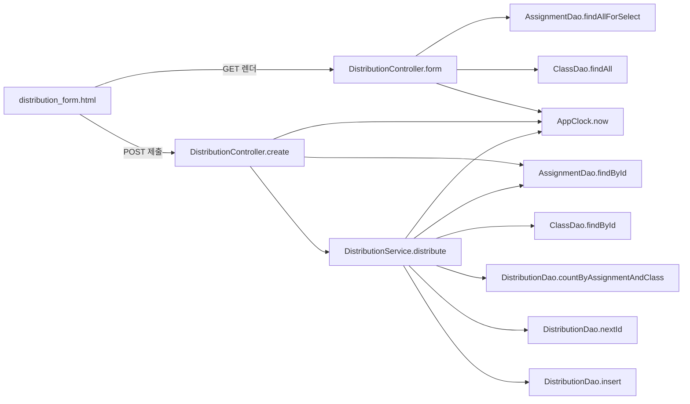

# 과제 배포(assignment) — ARCHITECTURE

> 대상: `legacy/assignment-thymeleaf` · 분석 범위: **새 배포 화면 하나와 그 화면이 부르는 코드**
> 근거는 `파일:줄번호` 이다. 자바 파일은 `legacy/assignment-thymeleaf/src/main/java/com/example/assign/` 접두어를, 템플릿은 `legacy/assignment-thymeleaf/src/main/resources/templates/` 접두어를 줄여 `web/DistributionController.java:60`, `distribution_form.html:16` 처럼 적었다.

## 1. 모듈 개요

- Spring Boot 3.3.4 + Thymeleaf + `JdbcTemplate`(JPA 없음) (`build.gradle:3`, `:25-27`).
- 계층은 `web`(컨트롤러) → `service` → `dao` → MariaDB `itembank` DB 순서다. 문항 은행과 같은 DB를 쓴다(`application.properties:2`, `db/mariadb/init/01-schema.sql:73`).
- 현재 시각은 모두 `AppClock.now()` 에서 가져오며, 기본값은 **2026-09-15 00:00:00 고정**이다(`AppClock.java:9`, `:14-19`). 시스템 속성 `app.clock=system` 일 때만 실제 시각을 쓴다.

## 2. 범위

| 구분 | 대상 |
|---|---|
| 범위 안 | `GET /distributions/new`(폼 표시), `POST /distributions`(배포 등록), 두 요청이 부르는 서비스 · DAO · 모델 · 템플릿 · `AppClock` · `DbErrorAdvice` |
| 범위 밖 | `GET /distributions`(배포 목록), `POST /distributions/{id}/redistribute`(재배포, `DistributionService.java:72-` 약 630줄), `GET /assignments`, `GET /` |

## 3. 폴더 구조 (범위 안 파일만)

```
legacy/assignment-thymeleaf/src/main/
├── java/com/example/assign/
│   ├── AppClock.java                 현재 시각(고정값) · 날짜 포맷
│   ├── web/DistributionController.java  form · create
│   ├── web/DbErrorAdvice.java        DataAccessException → db_error 화면
│   ├── service/DistributionService.java distribute (:46-68)
│   ├── dao/AssignmentDao.java        findAllForSelect · findById
│   ├── dao/ClassDao.java             findAll · findById
│   ├── dao/DistributionDao.java      countByAssignmentAndClass · nextId · insert
│   └── model/AssignmentRow.java, ClassRow.java
└── resources/templates/
    ├── distribution_form.html        새 배포 폼
    └── layout.html                   head · nav · flash · footer 조각
```

## 4. 진입점 표

| HTTP | URL | 처리 함수 | 근거 | 결과 |
|---|---|---|---|---|
| GET | `/distributions/new` | `DistributionController.form` | `web/DistributionController.java:40-47` | `distribution_form` 화면 |
| POST | `/distributions` | `DistributionController.create` | `web/DistributionController.java:49-77` | 성공 → `redirect:/distributions`, 실패 → `redirect:/distributions/new` + flash `error` |

- 요청 파라미터: `assignmentId`(long, 필수), `classId`(long, 필수) (`web/DistributionController.java:50-51`).

## 5. 의존 관계

### 5.1 구조 그림



### 5.2 호출 표

| 호출하는 쪽 | 호출되는 쪽 | 근거 |
|---|---|---|
| `DistributionController.form` | `AssignmentDao.findAllForSelect` | `web/DistributionController.java:42` |
| `DistributionController.form` | `ClassDao.findAll` | `web/DistributionController.java:43` |
| `DistributionController.form` | `AppClock.now` | `web/DistributionController.java:44` |
| `DistributionController.create` | `AssignmentDao.findById` | `web/DistributionController.java:53` |
| `DistributionController.create` | `AppClock.now`, `AppClock.fmt` | `web/DistributionController.java:58`, `:62` |
| `DistributionController.create` | `DistributionService.distribute` | `web/DistributionController.java:67` |
| `DistributionService.distribute` | `AssignmentDao.findById` | `service/DistributionService.java:48` |
| `DistributionService.distribute` | `ClassDao.findById` | `service/DistributionService.java:52` |
| `DistributionService.distribute` | `DistributionDao.countByAssignmentAndClass` | `service/DistributionService.java:59` |
| `DistributionService.distribute` | `DistributionDao.nextId` | `service/DistributionService.java:62` |
| `DistributionService.distribute` | `DistributionDao.insert`, `AppClock.now` | `service/DistributionService.java:63` |
| `distribution_form.html` | `layout.html` 의 `head` · `nav` · `flash` · `footer` 조각 | `distribution_form.html:3`, `:5`, `:7`, `:32` |
| (예외 발생 시) Spring | `DbErrorAdvice.dbError` | `web/DbErrorAdvice.java:11-17` |

- `create` 는 `distribute` 호출만 `try` 로 감싼다(`web/DistributionController.java:66-75`). 그 전의 `assignmentDao.findById`(`:53`)에서 DB 오류가 나면 `DbErrorAdvice` 가 `db_error` 화면을 보여 준다.
- `distribute` 에는 `@Transactional` 이 붙어 있다(`service/DistributionService.java:46`). 컨트롤러의 마감 검사(`web/DistributionController.java:60-65`)는 트랜잭션 밖에서 실행된다.

## 6. 가장 긴 함수 3개 (범위 안)

| 함수 | 근거 | 줄 수 |
|---|---|---|
| `DistributionController.create` | `web/DistributionController.java:49-77` | 29 |
| `DistributionService.distribute` | `service/DistributionService.java:46-68` | 23 |
| `AssignmentDao` 의 `MAPPER` | `dao/AssignmentDao.java:50-65` | 16 |

- 모듈 전체로 보면 범위 밖인 `DistributionService.redistribute`(`:71` 부터 파일 끝 `:701` 부근)가 압도적으로 길다.

## 7. 미확인 목록

1. **과제 앱은 실행해 보지 않았다.** 2026-09-29 확인 시 `localhost:8082` 가 응답하지 않았고 컨테이너도 없었다(compose `thymeleaf` 프로필). 화면 렌더링 결과는 코드로만 판단했다.
2. 운영 환경에서 `app.clock=system` 을 주는지 확인할 수 없다. `Dockerfile` · `docker-compose.yml` 에는 해당 설정이 없다.
3. `assignmentId` · `classId` 가 비었거나 숫자가 아닐 때의 응답은 코드에 처리가 없어 Spring 기본 동작(400 추정)에 맡겨진다. 실행 확인하지 않았다.
4. 시드의 배포 #3 · #4 는 같은 (과제 2, 1반)이다(`db/mariadb/init/02-seed.sql:133-134`). 시드 주석은 "4번은 재배포 이력"이라 하지만(`:128`), 현재 재배포 코드는 행을 새로 넣지 않고 `redistributed = 1` 로 UPDATE 만 한다(`dao/DistributionDao.java:65-67`, `service/DistributionService.java:620`). 이 행을 만든 경로는 코드에서 찾지 못했다.
