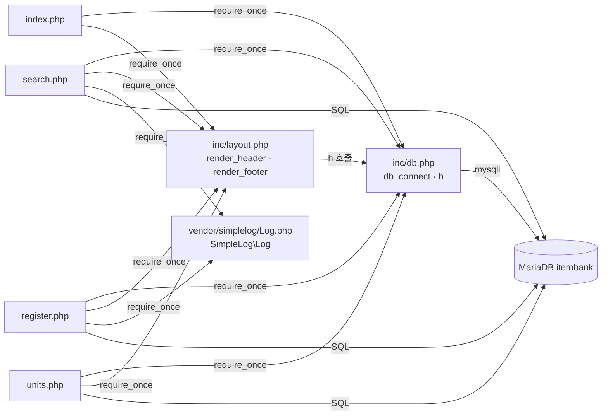

# 문항 은행(item-bank) — ARCHITECTURE

> 대상: `legacy/item-bank-php` · 분석 범위: 진입점 · 의존 관계 (Day 1-2 실습 2)
> 모든 근거는 저장소 루트 기준 `파일:줄번호` 입니다. 직접 열어 확인하지 못한 것은 "미확인"으로 적었습니다.

## 1. 모듈 개요

- PHP 7.4 + Apache 이미지에 소스를 그대로 복사해 띄우는 프레임워크 없는 페이지 스크립트 모듈이다 (`legacy/item-bank-php/Dockerfile:1`, `:14`).
- 화면은 3개다: 문항 검색 · 문항 등록 · 단원 목록 (`legacy/item-bank-php/index.php:9-11`).
- DB 접근은 mysqli 로 MariaDB `itembank` 에 직접 SQL 을 보내며, ORM · 리포지토리 계층이 없다 (`legacy/item-bank-php/inc/db.php:16`, `:21`).
- 화면 파일 안에서 입력 처리 · SQL · HTML 출력을 함께 한다. 특히 `search.php` 는 731줄이고 그중 `buildSearchQuery` 하나가 523줄이다 (`legacy/item-bank-php/search.php:42-564`).
- compose 프로필 `php` 로 기동하며 호스트 8081 → 컨테이너 80 이다 (`docker-compose.yml:35-39`).

## 2. 폴더 구조

```
legacy/item-bank-php/
├── Dockerfile               # php:7.4-apache + mysqli, 소스 전체를 /var/www/html 로 복사 (Dockerfile:1-14)
├── index.php          14줄  # 홈 · 메뉴
├── search.php        731줄  # 문항 검색 (함수 4개 + 실행부)
├── register.php      177줄  # 문항 등록 (함수 없음, 최상위 스크립트)
├── units.php          48줄  # 단원 목록
├── inc/
│   ├── db.php         37줄  # db_connect(), h()
│   └── layout.php     43줄  # render_header(), render_footer()
└── vendor/simplelog/
    └── Log.php        54줄  # 외부 라이브러리(더미). "수정하지 말 것" (vendor/simplelog/Log.php:3)
```

`.htaccess` · 라우터 · 설정 파일은 없다(`find` 로 확인). URL 은 파일 경로와 1:1 이다.

## 3. 진입점 표

| URL · 화면 | 처음 실행되는 파일 | 그 파일이 부르는 주요 함수 (호출 순서) | 근거 |
| --- | --- | --- | --- |
| `/` , `/index.php` · 홈 | `legacy/item-bank-php/index.php` | `render_header('홈')` → 메뉴 HTML 출력 → `render_footer()` | `index.php:5`, `:9-11`, `:14` |
| `GET /search.php` · 문항 검색 | `legacy/item-bank-php/search.php` | `render_header` → `db_connect` → `buildSearchQuery($_GET, $conn)` → `renderSearchForm` → `runSearchQuery` → `renderResultTable` → (예외 시 `Log::error`) → `render_footer` | `search.php:709`, `:713`, `:722-725`, `:727`, `:731` |
| `GET /register.php` · 문항 등록 폼 | `legacy/item-bank-php/register.php` | `db_connect` → 단원 · 태그 목록 SELECT → `render_header` → 폼 출력 → `render_footer` | `register.php:17`, `:27`, `:34`, `:127`, `:141`, `:177` |
| `POST /register.php` · 문항 등록 저장 | `legacy/item-bank-php/register.php` | 위 GET 흐름 + POST 분기: 입력 검증 → 트랜잭션(`MAX(id)+1` 채번 → `INSERT item` → `INSERT item_tag`) → `Log::info` / 실패 시 `rollback` + `Log::error` | `register.php:40`, `:47-81`, `:85-114`, `:115`, `:120-121` |
| `GET /units.php` · 단원 목록 | `legacy/item-bank-php/units.php` | `render_header` → `db_connect` → 단원 + 공개 문항 수 SELECT 1회 → 표 출력 → `render_footer` | `units.php:5`, `:8`, `:16-20`, `:48` |

- 등록 폼은 자기 자신에게 POST 한다 (`register.php:141`). 검색 폼은 자기 자신에게 GET 한다 (`search.php:632`).
- 모든 화면 머리말의 메뉴 링크(검색 · 등록 · 단원)는 `render_header` 가 만든다 (`inc/layout.php:9-13`, `:31-34`).

## 4. 의존 관계

### 4.1 구조 그림



화살표는 "A → B (A가 B를 포함하거나 호출)" 방향이다. `inc/layout.php` 는 `inc/db.php` 를 `require` 하지 않고 `h()` 를 호출만 한다. 따라서 호출하는 쪽 파일이 `db.php` 를 먼저 포함해야 한다(4개 진입점 모두 `db.php` → `layout.php` 순서로 포함).

### 4.2 호출 표

| 호출하는 쪽 | → 호출받는 쪽 | 종류 | 근거 |
| --- | --- | --- | --- |
| `index.php` | → `inc/db.php` | require_once | `index.php:2` |
| `index.php` | → `inc/layout.php` | require_once | `index.php:3` |
| `index.php` | → `render_header`, `render_footer` | 함수 호출 | `index.php:5`, `:14` |
| `search.php` | → `inc/db.php`, `inc/layout.php`, `vendor/simplelog/Log.php` | require_once | `search.php:20-22` |
| `search.php` (실행부) | → `db_connect` | 함수 호출 | `search.php:713` |
| `search.php` (실행부) | → `buildSearchQuery` → `renderSearchForm` → `runSearchQuery` → `renderResultTable` | 함수 호출 | `search.php:722-725` |
| `search.php` (실행부) | → `Log::setThreshold`, `Log::error` | 정적 메서드 | `search.php:27`, `:727` |
| `buildSearchQuery` | → `$conn->prepare` (unit 이름 조회) | mysqli | `search.php:125` |
| `buildSearchQuery` | → `$conn->query` (unit 목록, tag 목록) | mysqli | `search.php:156`, `:178` |
| `buildSearchQuery` | → `Log::debug`, `Log::error` | 정적 메서드 | `search.php:103`, `:528`, `:537` |
| `buildSearchQuery` | → `h` | 함수 호출 | `search.php:360`, `:365`, `:416` 외 |
| `runSearchQuery` | → `$conn->prepare` (건수 SQL, 목록 SQL) | mysqli | `search.php:577`, `:600` |
| `renderResultTable` | → `h` | 함수 호출 | `search.php:674-678` |
| `register.php` | → `inc/db.php`, `inc/layout.php`, `vendor/simplelog/Log.php` | require_once | `register.php:2-4` |
| `register.php` | → `db_connect` | 함수 호출 | `register.php:17` |
| `register.php` | → `$conn->query` (unit 목록, tag 목록, `MAX(id)+1`) | mysqli | `register.php:27`, `:34`, `:87` |
| `register.php` | → `$conn->prepare` (`INSERT item`, `INSERT item_tag`) | mysqli | `register.php:92-95`, `:105` |
| `register.php` | → `Log::info`, `Log::error` | 정적 메서드 | `register.php:115`, `:121` |
| `register.php` | → `render_header`, `render_footer`, `h` | 함수 호출 | `register.php:127`, `:177`, `:131` 외 |
| `units.php` | → `inc/db.php`, `inc/layout.php` | require_once | `units.php:2-3` |
| `units.php` | → `db_connect`, `$conn->query` | 함수 호출 · mysqli | `units.php:8`, `:20` |
| `inc/layout.php` `render_header` | → `h` (inc/db.php 에 정의) | 함수 호출 | `inc/layout.php:17`, `:33` · 정의 `inc/db.php:34-37` |
| `inc/db.php` `db_connect` | → `mysqli` (환경 변수 `DB_HOST` 등, 없으면 기본값) | 생성자 | `inc/db.php:14-21` |
| `SimpleLog\Log::write` | → `error_log` (화면 출력 없음) | 내장 함수 | `vendor/simplelog/Log.php:43-53` |

- 가장 많이 불리는 함수는 `h()` 다. 모든 화면 파일과 `inc/layout.php` 가 부른다.
- `db_connect()` 는 `static $conn` 으로 요청당 연결 1개를 재사용한다 (`inc/db.php:9-12`).

## 5. 가장 긴 함수 3개

| 순위 | 파일 | 함수 | 시작–끝 | 길이 | 하는 일 |
| --- | --- | --- | --- | --- | --- |
| 1 | `legacy/item-bank-php/search.php` | `buildSearchQuery` | 42–564 | 523줄 | GET 파라미터를 검증해 WHERE · ORDER BY · LIMIT 을 조립하고, 폼 · 정렬 링크 · 페이지 링크 · 경고 HTML 까지 한꺼번에 만든다 |
| 2 | `legacy/item-bank-php/search.php` | `renderResultTable` | 647–704 | 58줄 | 경고 · 조건 요약 · 건수 · 결과 표 · 페이지 이동 링크를 출력한다 |
| 3 | `legacy/item-bank-php/search.php` | `runSearchQuery` | 571–624 | 54줄 | 조립된 건수 SQL 과 목록 SQL 을 같은 바인딩으로 두 번 실행해 `total` · `rows` 를 돌려준다 |

참고: `register.php` 는 함수 없이 최상위 스크립트로 작성돼 있고, POST 처리 블록만 86줄이다 (`register.php:40-125`). 함수 순위에는 넣지 않았다.

## 6. 미확인 목록

| 항목 | 이유 |
| --- | --- |
| `v_item_public` 뷰의 정의(어떤 테이블 · 조건으로 만들어지는지) | 검색은 이 뷰만 조회한다(`search.php:522`). 정의는 `legacy/item-bank-php` 안에 없다. 실습 3(데이터 흐름)에서 DB 초기화 스크립트를 확인한다. **→ 확인됨(2026-09-29, 교차 검증)**: `item JOIN unit` + `WHERE i.status = 'A'`(`db/mariadb/init/01-schema.sql:52-70`). 기동 중 DB 의 뷰 정의도 같다. ERD.md §1, BUSINESS-RULES.md BR-01 참고 |
| `item`, `unit`, `tag`, `item_tag` 테이블의 스키마 · 제약 | 모듈 코드에는 SQL 사용처만 있다. 실습 3에서 확인한다 |
| 등록 직후 `status='R'` 문항이 검색에서 빠지는 실제 메커니즘 | 주석(`register.php:84`)과 알림 문구(`register.php:116`)에만 적혀 있다. 뷰 정의를 보기 전까지는 규칙으로 확정하지 않는다. **→ 확인됨(2026-09-29, 교차 검증)**: `'R'` 로 INSERT(`register.php:94`)하고, 검색 뷰는 `status='A'` 만 담는다(`01-schema.sql:70`). BUSINESS-RULES.md BR-26 참고 |
| `inc/`, `vendor/` 파일을 URL 로 직접 요청했을 때의 동작 | 막는 설정(`.htaccess` 등)은 없다. 정의만 있는 파일이라 출력은 없을 것으로 보이지만 요청해 보지 않았다 |
| 다른 모듈(`assignment` 등)이 이 모듈의 파일이나 테이블을 쓰는지 | 분석 범위를 `legacy/item-bank-php` 로 한정했다 |
