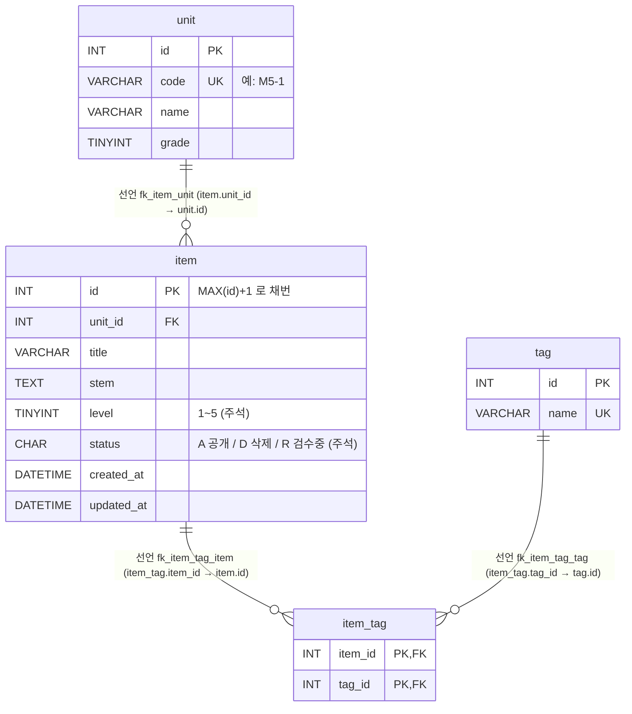

# 문항 은행(item-bank) — ERD · 데이터 흐름

> 대상: `legacy/item-bank-php` · 분석 범위: 데이터 흐름 (Day 1-2 실습 3)
> 선행 문서: `docs/item-bank/ARCHITECTURE.md`. 그 문서의 미확인 항목 중 `v_item_public` 정의 · 테이블 스키마 · `status='R'` 제외 메커니즘을 여기서 확인했다.
> 모든 근거는 저장소 루트 기준 `파일:줄번호` 이다. 스키마는 `db/mariadb/init/01-schema.sql` 이고, 기동 중인 MariaDB 의 `SHOW FULL TABLES` · `information_schema.KEY_COLUMN_USAGE` 결과와 일치함을 확인했다.

## 1. 테이블 목록

이 모듈이 읽거나 쓰는 객체만 적었다. 같은 DB 에 있는 `class` · `assignment` · `distribution` · `submission` 은 과제 배포 모듈용이고 이 모듈 코드에서는 쓰지 않는다(§5 참고).

| 이름 | 종류 | 주요 컬럼 | 키 · 제약 | 근거 |
| --- | --- | --- | --- | --- |
| `unit` | 테이블 | `id` INT, `code` VARCHAR(16), `name` VARCHAR(100), `grade` TINYINT | PK `id`, UNIQUE `code` (`uk_unit_code`) | `db/mariadb/init/01-schema.sql:11-18` |
| `item` | 테이블 | `id` INT, `unit_id` INT, `title` VARCHAR(200), `stem` TEXT, `level` TINYINT, `status` CHAR(1) 기본 `'A'`, `created_at` · `updated_at` DATETIME | PK `id`, FK `unit_id → unit.id`, INDEX `unit_id`, INDEX `level`. `id` 는 AUTO_INCREMENT 가 아니다 | `db/mariadb/init/01-schema.sql:20-33` |
| `tag` | 테이블 | `id` INT, `name` VARCHAR(50) | PK `id`, UNIQUE `name` (`uk_tag_name`) | `db/mariadb/init/01-schema.sql:35-40` |
| `item_tag` | 테이블(N:M 연결) | `item_id` INT, `tag_id` INT | PK (`item_id`, `tag_id`), FK `item_id → item.id`, FK `tag_id → tag.id` | `db/mariadb/init/01-schema.sql:42-48` |
| `v_item_public` | 뷰 | `id`, `unit_id`, `unit_code`, `unit_name`, `unit_grade`, `title`, `stem`, `level`, `created_at`, `updated_at`, `tag_names` | `item JOIN unit` + `WHERE i.status = 'A'`. `tag_names` 는 태그 이름을 `tag.id` 순으로 쉼표 연결 | `db/mariadb/init/01-schema.sql:52-70` |

컬럼 값에 대한 메모

- `item.level` 의 1~5 범위는 스키마에서 **주석뿐**이다(`01-schema.sql:25`). CHECK 제약은 없다. 1~5 검증은 등록 화면 코드가 한다(`legacy/item-bank-php/register.php:70`).
- `item.status` 의 의미 `A=공개 D=삭제 R=검수중` 도 스키마 **주석**이다(`01-schema.sql:26`). 코드에서 쓰는 값은 `'A'`(읽기: `01-schema.sql:70`, `legacy/item-bank-php/units.php:17`)와 `'R'`(쓰기: `legacy/item-bank-php/register.php:94`)뿐이다. `'D'` 는 시드 데이터에만 있고 모듈 코드는 이 값을 쓰지도, 따로 조회하지도 않는다.
- `unit.code` 는 UNIQUE 지만 테이블 정렬 규칙이 `utf8mb4_unicode_ci`(대소문자 무시)다(`01-schema.sql:18`). 그래서 검색의 `unit_code = ?`(`legacy/item-bank-php/search.php:118`)와 이름 조회 `code = ?`(`search.php:125`)는 소문자 `m5-1` 도 `M5-1` 과 같게 본다. 코드 주석 "정확히 일치"(`search.php:107`)와 다르다(BUSINESS-RULES.md BR-07).

## 2. 테이블 관계

| 관계 | 구분 | 근거 (선언) | 코드에서 이 관계로 JOIN 하는 곳 |
| --- | --- | --- | --- |
| `unit` 1 — N `item` | **선언** | `01-schema.sql:32` | 뷰 `01-schema.sql:69`, `units.php:17` (상관 서브쿼리 `i.unit_id = u.id`) |
| `item` 1 — N `item_tag` | **선언** | `01-schema.sql:46` | 뷰 `01-schema.sql:67`, `search.php:244-245` (`it.item_id = v_item_public.id`) |
| `tag` 1 — N `item_tag` | **선언** | `01-schema.sql:47` | 뷰 `01-schema.sql:66`, `search.php:244` (`t.id = it.tag_id`) |

- **추정 관계는 없다.** 코드의 JOIN · 서브쿼리 조건 4곳이 모두 선언된 외래 키와 같은 컬럼 쌍이다.
- `v_item_public` 은 `item`, `unit`, `item_tag`, `tag` 에서 만든 **파생 객체**라 관계선에 넣지 않았다. 구성은 `item ⋈ unit (status='A')` + `item_tag ⋈ tag` 서브쿼리다(`01-schema.sql:64-70`).
- 검색의 단원 조건은 `unit.id` 가 아니라 뷰의 `unit_code`(= `unit.code`)로 비교한다(`search.php:118`). 태그 조건은 `tag.id` 가 아니라 `tag.name` 으로 비교한다(`search.php:245`). 두 컬럼 모두 UNIQUE 라 결과는 1:1 로 대응한다(`01-schema.sql:17`, `:39`).

## 3. 읽기 · 쓰기 위치

`register.php` 와 `units.php` 는 함수 없이 최상위 스크립트로 되어 있어(ARCHITECTURE.md §5) 함수 칸에 "최상위"라고 적었다.

### 3.1 테이블별

| 테이블 | 읽기 (SELECT) — 파일 · 함수 · 근거 | 쓰기 (INSERT · UPDATE · DELETE) — 파일 · 함수 · 근거 |
| --- | --- | --- |
| `unit` | `search.php` `buildSearchQuery` — 코드로 이름 · 학년 조회 `:125`, 폼 목록 `:156` `register.php` 최상위 — 폼 목록 · 단원 검증용 `:27` `units.php` 최상위 — 단원 목록 `:16-20` (간접) `v_item_public` 경유 — `search.php` `runSearchQuery` `:577`, `:600` | 없음 |
| `item` | `register.php` 최상위 — 다음 ID 채번 `SELECT COALESCE(MAX(id),0)+1 … FOR UPDATE` `:87` `units.php` 최상위 — 단원별 `status='A'` 건수 `:17` (간접) `v_item_public` 경유 — `search.php` `runSearchQuery` `:577`, `:600` | **INSERT** `register.php` 최상위 `:92-95` (`status='R'`, `created_at` · `updated_at` = `NOW()`) UPDATE · DELETE: 없음 |
| `tag` | `search.php` `buildSearchQuery` — 폼 목록 `:178`, 태그 조건 EXISTS 서브쿼리 `:244` `register.php` 최상위 — 폼 목록 · 태그 검증용 `:34` (간접) `v_item_public.tag_names` 경유 — `search.php` `runSearchQuery` | 없음 |
| `item_tag` | `search.php` `buildSearchQuery` 가 조립한 EXISTS 서브쿼리 `:244-245` → `runSearchQuery` `:577`, `:600` 에서 실행 (간접) `v_item_public.tag_names` 경유 | **INSERT** `register.php` 최상위 `:105-111` (검증을 통과한 태그마다 1행) UPDATE · DELETE: 없음 |
| `v_item_public` (뷰) | `search.php` — SQL 은 `buildSearchQuery` 가 조립(`:521-526`), 실행은 `runSearchQuery` (건수 `:577`, 목록 `:600`) | 해당 없음 (뷰) |

- 모듈 전체에서 UPDATE · DELETE 문은 **0건**이다. `grep` 의 `UPDATE` 적중은 `register.php:87` 의 잠금 절 `FOR UPDATE` 하나뿐이다.
- 쓰기는 `register.php` 한 곳뿐이며 `item` → `item_tag` 순서로 한 트랜잭션 안에서 한다(`register.php:85`, `:114`, 실패 시 `:120` rollback).

### 3.2 화면별 흐름 요약

| 화면 | 읽는 것 | 쓰는 것 |
| --- | --- | --- |
| 문항 검색 `search.php` | `unit`, `tag`, `item_tag`, `v_item_public` | 없음 |
| 문항 등록 `register.php` | `unit`, `tag`, `item`(MAX id) | `item`, `item_tag` |
| 단원 목록 `units.php` | `unit`, `item` | 없음 |

`status` 가 흐르는 길: 등록 화면이 `'R'` 로 INSERT 한다(`register.php:94`). 검색은 `status='A'` 인 행만 담는 뷰를 읽고(`01-schema.sql:70`), 단원 목록은 `status='A'` 로 센다(`units.php:17`). 따라서 **등록 직후 문항은 검색과 단원 목록 건수 양쪽에서 빠진다.** `R → A` 로 바꾸는 코드는 이 모듈에 없다(§4).

## 4. 미확인

| 항목 | 이유 |
| --- | --- |
| `item.status` 를 `R → A` 또는 `A → D` 로 바꾸는 주체 | 모듈 안에 UPDATE 문이 없다. 검수 · 삭제를 다른 시스템이나 수작업으로 하는지 알 수 없다 |
| `D`(삭제) 상태의 실제 쓰임 | 스키마 주석(`01-schema.sql:26`)과 시드에만 나온다. 모듈 코드에서는 쓰지도 조회하지도 않는다 |
| `item.id` 채번(`MAX(id)+1 … FOR UPDATE`)이 동시 등록에서 안전한지 | 코드상 트랜잭션과 잠금은 있다(`register.php:85-87`). 실제 동시 요청으로는 확인하지 않았다 |
| `tag_names` 의 `GROUP_CONCAT` 길이 제한(`group_concat_max_len`) 설정값 | 서버 설정을 조회하지 않았다. 태그 수가 적어 지금 데이터에서는 영향이 없을 것으로 보이나 미확인 |
| 이 모듈 밖에서 `item` · `item_tag` 에 쓰는 코드가 있는지 | 분석 범위를 `legacy/item-bank-php` 로 한정했다 |

## 5. 주의 — 주석과 코드가 다른 곳

| 위치 | 주석 | 실제 코드 |
| --- | --- | --- |
| `db/mariadb/init/01-schema.sql:51` | "검색 화면 search.php 와 **등록 화면이 모두** 이 뷰를 기준으로 삼는다" | 등록 화면은 `v_item_public` 을 참조하지 않는다. 뷰 이름은 `search.php:522` 에서만 나온다(`grep` 확인). 등록 화면은 `unit` · `tag` · `item` 테이블을 직접 읽고 쓴다 |

참고: `unit` 은 과제 배포 모듈의 `assignment.unit_id` 도 참조한다(`01-schema.sql:89`, 선언). 그래서 `unit` 을 바꾸면 두 모듈에 함께 영향이 간다.
